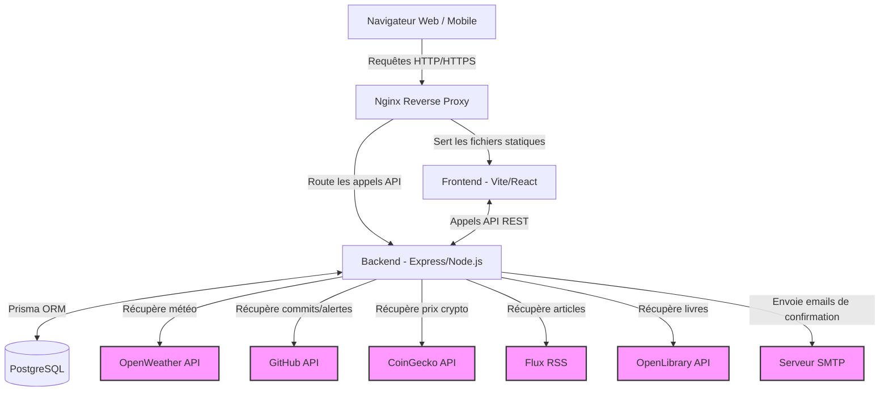

# Orbit Dashboard

**Orbit** is a personalised web dashboard that aggregates information from multiple services into a single interface. Each user can add, configure, move, and delete widgets, with each one refreshing at its own independent rate.

## Purpose and Use Cases
Orbit is designed to be a central hub for your daily information needs. Instead of opening multiple tabs for weather, news, code repositories, and financial data, Orbit brings them all into one customizable view. 
- **Developers** can monitor their GitHub repository commits and security alerts alongside their local weather.
- **Crypto Enthusiasts** can track top coins and specific coin prices in real-time.
- **Readers and News Junkies** can combine RSS feeds from their favorite blogs with book information from Open Library.

---

## Features

- **Full authentication** — registration with email, mandatory account confirmation, and secure login via `httpOnly` session cookie.
- **Dynamic dashboard** — add, drag-and-drop, reconfigure, and delete widgets independently.
- **Per-widget refresh rate** — each widget instance has its own timer and updates automatically.
- **Five integrated services** — Weather, RSS, GitHub, Crypto, and Open Library.
- **OAuth 2.0 (GitHub)** — link your GitHub account to unlock GitHub widgets; the access token is stored encrypted in the database (AES-256-GCM).
- **Administration panel** — list users, confirm accounts manually, promote to admin, or delete accounts.
- **Responsive design** — works on mobile, tablet, and desktop.

---

## Architecture

The project is split into two main parts, orchestrated by Docker Compose:

```
.
├── backend/        # Node.js · Express · Prisma ORM (PostgreSQL)
├── frontend/       # React 18 · TypeScript · Vite → served by Nginx
├── compose.yaml    # Full infrastructure (db, backend, frontend, adminer)
└── README.md
```

### Backend
A REST API built with **Node.js** and **Express**. It exposes the `/about.json` contract, handles session-based authentication (secure cookies), encrypts sensitive data before storing it, and acts as a proxy toward external APIs to keep secrets server-side.

### Frontend
A single-page application built with **React 18** and **TypeScript** (bundled by **Vite**). It manages the widget state, handles async data fetching, and is served in production by **Nginx**.

### Database
**PostgreSQL** managed through **Prisma ORM**. The schema is version-controlled via Prisma migrations and seeded automatically on first start.

---

## Services and Widgets

| Service | Widget | Parameters | Requires account |
|---|---|---|---|
| **Weather** | `city_temperature` — current temperature | `city` (string) | No |
| **Weather** | `forecast` — daily min/max forecast | `city` (string), `days` (integer) | No |
| **RSS** | `article_list` — latest articles | `link` (string), `number` (integer) | No |
| **RSS** | `feed_headline` — most recent headline | `link` (string) | No |
| **GitHub** | `recent_commits` — latest commits | `repo` (string), `number` (integer) | Yes (OAuth) |
| **GitHub** | `security_alerts` — Dependabot alerts | `repo` (string) | Yes (OAuth) |
| **Crypto** | `coin_price` — current price of a coin | `coin` (string), `currency` (string) | No |
| **Crypto** | `top_coins` — top N coins by market cap | `number` (integer) | No |
| **Open Library** | `book_info` — book details by title | `title` (string) | No |
| **Open Library** | `author_books` — books by an author | `author` (string), `number` (integer) | No |

Weather data comes from [Open-Meteo](https://open-meteo.com/), crypto data from [CoinGecko](https://www.coingecko.com/), and book data from [Open Library](https://openlibrary.org/). All three are free public APIs that require no API key.

---

## Requirements

- **Docker** and **Docker Compose** (v2 recommended) — that is all you need.
- Optional: Node.js 20+ and npm if you want to run the project locally without Docker.

---

## Quick Start (Docker — recommended)

### 1. Clone the repository

```bash
git clone <repository-url>
cd <repository-directory>
```

### 2. Configure environment variables

The repository ships with a ready-to-use `backend/.env` file for local development. The only values that require your own credentials are the GitHub OAuth settings:

```env
GITHUB_CLIENT_ID=<your-github-oauth-app-client-id>
GITHUB_CLIENT_SECRET=<your-github-oauth-app-client-secret>
GITHUB_REDIRECT_URI=http://localhost:8080/services/github/callback
```

> To create a GitHub OAuth App, go to **GitHub → Settings → Developer settings → OAuth Apps → New OAuth App**.  
> Set the callback URL to `http://localhost:8080/services/github/callback`.

All other variables (database credentials, encryption key, port) are pre-filled and work out of the box.

### 3. Build and start

```bash
docker compose up --build
```

That is the only command you need. Docker Compose will:
1. Start a PostgreSQL database and wait until it is healthy.
2. Run Prisma migrations and seed the database (admin account + schema).
3. Start the backend API on port `8080`.
4. Build the React frontend and serve it via Nginx on port `3000`.

### 4. Open the app

| URL | Description |
|---|---|
| `http://localhost:3000` | Web interface (frontend) |
| `http://localhost:8080` | REST API (backend) |
| `http://localhost:8080/about.json` | Service and widget metadata |
| `http://localhost:8081` | Adminer — database browser |

---

## Default Admin Account

A default administrator account is created automatically by the Prisma seed script:

| Field | Value |
|---|---|
| Email | `admin@admin.com` |
| Password | `admin1234` |

Use it to access the **Admin** tab in the top navigation bar, where you can confirm user accounts, promote users to admin, or delete accounts.

---

## Connecting GitHub

GitHub widgets require your account to be linked via OAuth:

1. Log in to the dashboard.
2. Add a GitHub widget — if your account is not linked, an error message with a **"Connect GitHub"** link will appear.
3. Click the link, authorise the application on GitHub, and you will be redirected back to your dashboard automatically.

Your GitHub access token is **encrypted with AES-256-GCM** before being stored in the database. It is never stored or transmitted in plain text.

---

## Account Confirmation

After registering, your account must be confirmed before you can log in. For convenience during development, the confirmation link is directly displayed in the frontend interface upon successful registration. You can simply click it to confirm your account.

Alternatively, an administrator can confirm your account manually from the Admin panel.

---

## API Contract — `/about.json`

The backend exposes its service and widget catalogue at `GET /about.json`:

```json
{
  "client": { "host": "::1" },
  "server": {
    "current_time": 1234567890,
    "services": [
      {
        "name": "weather",
        "widgets": [
          {
            "name": "city_temperature",
            "description": "...",
            "params": [{ "name": "city", "type": "string" }]
          }
        ]
      }
    ]
  }
}
```

This endpoint is public (no authentication required) and always reflects the actual services and widgets available in the application.

---

## Local Development (without Docker)

### Backend

```bash
cd backend
npm install
# Start a local PostgreSQL instance, then:
npx prisma migrate dev
npx prisma db seed
npm run dev     # starts on port 8080
```

### Frontend

```bash
cd frontend
npm install
npm run dev     # starts on port 5173 with proxy to localhost:8080
```

---


## 🏗️ Diagramme d'Architecture


